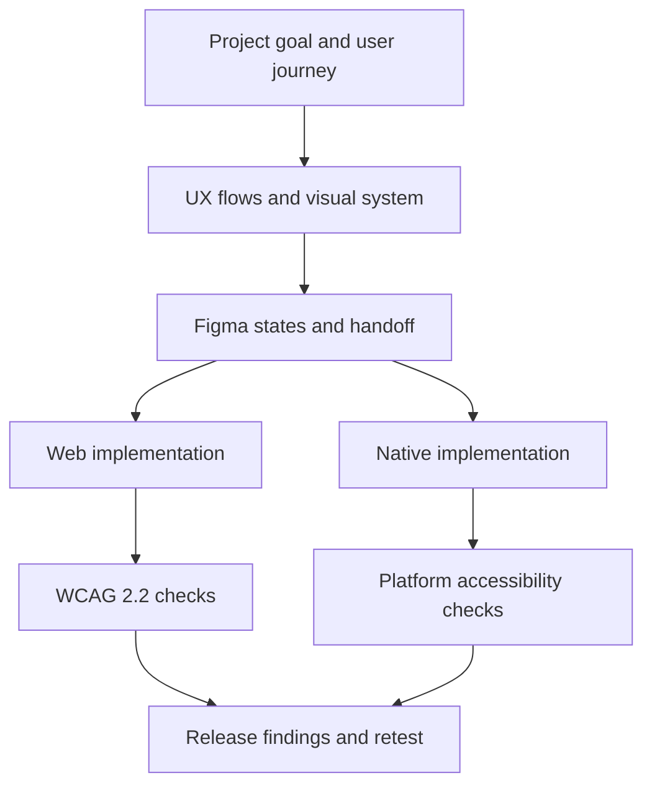

# PANTIK UI/UX knowledge map

[Run the original audit](README.md#run-an-audit) · [Run a WCAG 2.2 audit](12-wcag/README.md) · [Record findings](07-report/audit-report.md)

## Find the right section

| Topic | Open when you need |
| --- | --- |
| [UX and journeys](01-ux/checklist.md) | User goals, task flow and clear navigation. |
| [Visual systems and Material 3](02-ui-material/checklist.md) | Visual hierarchy, states, components and design tokens. |
| [Accessibility checklist](03-accessibility/checklist.md) | A first pass across designs, websites and apps. |
| [Web implementation](04-web/checklist.md) | Responsive and functional website checks. |
| [Native implementation](05-mobile-app/checklist.md) | Platform behavior and accessibility APIs. |
| [Figma and handoff](06-figma/checklist.md) | Interactive states, responsive variants and implementation notes. |
| [Material implementations](README.md#checklist-by-topic) | Library-specific checks for web, Android and iOS. |
| [Release matrix](07-report/release-matrix.md) | Coverage by device, browser, platform, locale and flow. |
| [Report and remediation](07-report/audit-report.md) | Evidence, findings, fixes and retests. |
| [Core source register](08-sources/sources.md) | Design guidance, library documentation and platform sources. |
| [Codex audit prompt](09-codex/run-audit.md) | A repeatable workflow for auditing a project with Codex. |

## Explore WCAG 2.2

| Principle | Groups | Common starting points |
| --- | --- | --- |
| [1. Perceivable](12-wcag/criteria.md#1-perceivable) | 1.1 text alternatives, 1.2 media, 1.3 adaptable content, 1.4 distinction | Image alternatives, captions, semantic structure, contrast, zoom and reflow. |
| [2. Operable](12-wcag/criteria.md#2-operable) | 2.1 keyboard, 2.2 timing, 2.3 flashes and motion, 2.4 navigation, 2.5 input | Keyboard, visible focus, sticky overlays, input targets, motion and drag alternatives. |
| [3. Understandable](12-wcag/criteria.md#3-understandable) | 3.1 language, 3.2 predictability, 3.3 input assistance | RU/EN/PL language settings, clear labels and errors, consistent help and sign-in. |
| [4. Robust](12-wcag/criteria.md#4-robust) | 4.1 compatibility | Accessible names, roles, states and live announcements. |

Start with the [criterion index](12-wcag/criteria.md) to find the requirement and its explanation. Use the [audit CSV](12-wcag/WCAG-2.2-Audit.csv) to track results, and the [W3C source register](12-wcag/sources.md) to look up techniques, test rules and historical editions.
